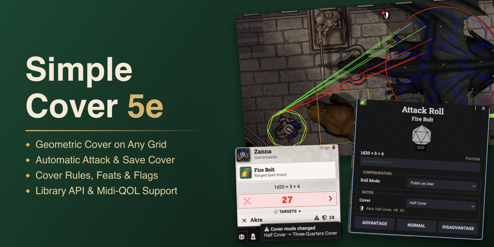
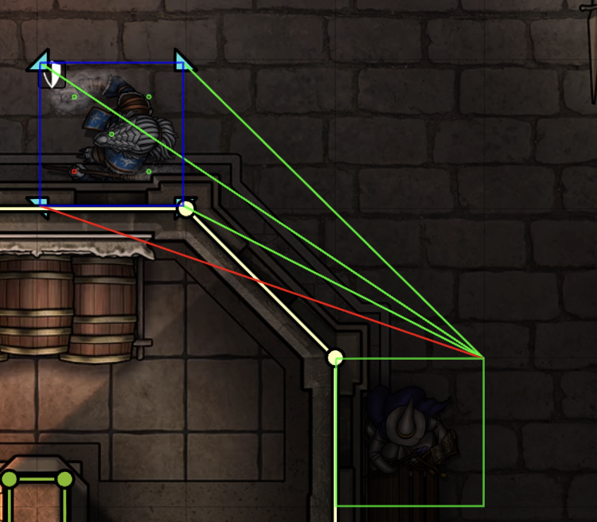
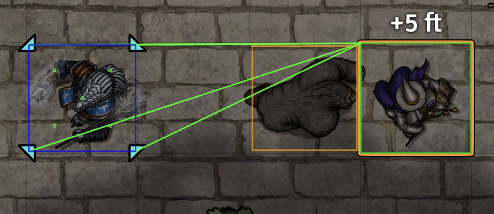
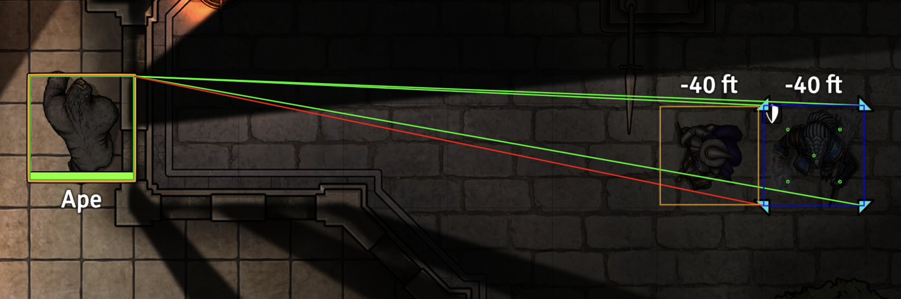
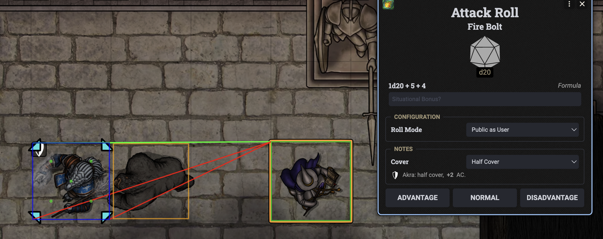
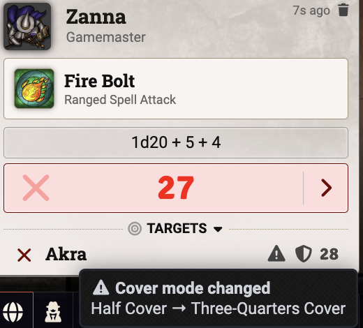
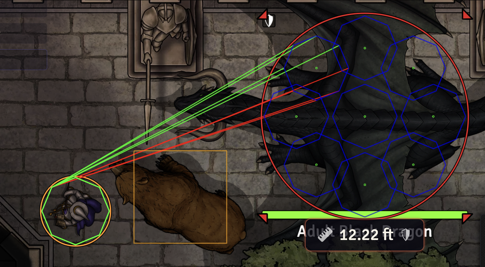

**Simple Cover 5e** works out cover for attacks and saving throws in the dnd5e system and applies it to the
roll.

Cover is measured on the scene itself. The module traces lines from the attacker to the target, and walls,
creatures, and Regions in the way block them. The share of blocked lines sets Half Cover or Three-Quarters
Cover. A line-of-sight check adds Total Cover.

The bonus goes straight into the roll, as a higher AC or as a bonus on Dexterity saving throws. It works on
square, hex, and gridless scenes.

## Contents

- [Getting Started](#getting-started)
- [Cover Evaluation](#cover-evaluation)
- [Cover Rules](#cover-rules)
- [Automation](#automation)
- [Hover & Debug](#hover--debug)
- [Compatibility](#compatibility)
- [Settings](#settings)
- [Credits & License](#credits--license)

---

## Getting Started

Activate the module in a dnd5e world. There is nothing to set up: target a token and roll an attack, or let a
spell force a Dexterity saving throw, and the module evaluates cover for you.

The result shows up in the roll dialog and as a cover condition on the target, see [Automation](#automation).
Everything else is optional, see [Settings](#settings).

---

## Cover Evaluation

- **Cover Lines.** The module picks the attacker corner with the clearest view and traces a line to each
  corner of the target.
- **Grids.** On gridless scenes tokens count as squares or circles, and large tokens are sampled at several
  points to approximate a multi-space footprint.
- **Walls.** Walls that block sight block Cover Lines.
- **Creatures.** Other creatures block lines as 3D bodies with their real token shape. Hidden and defeated
  creatures, ethereal ones, and creatures with 0 max HP are ignored.
- **Height and Elevation.** Lines run in 3D. A creature's height comes from the token's depth and the scene's
  grid distance, so a tall creature blocks a line that a short one lets pass. Prone creatures can count as
  smaller (see [Settings](#settings)).
- **Cover Obstacle Regions.** Add the Cover Obstacle behavior to a Region and it blocks Cover Lines like a
  creature would, for terrain that is neither a wall nor a token. The GM sets whether it grants Half Cover or
  Three-Quarters Cover.
- **Obstacle filters.** Target tokens of chosen sizes or creature types ignore the obstacle.
- **Inside a Region.** When attacker and target both stand inside, Interior Block Distance decides. 0 always
  blocks, a larger value blocks once the two are farther apart, and Infinite never blocks.
- **Line of Sight.** The Wall Line of Sight Check tests the view from the attacker's vision position
  to the target and grants Total Cover when walls block it.

The screenshots show the debug overlay (see [Hover & Debug](#hover--debug)).

<table>
  <tr>
    <td width="40%">
      <strong>Wall blocking a Cover Line</strong> 
      
    </td>
    <td width="60%">
      <strong>Height difference between tokens</strong> 
      
    </td>
  </tr>
</table>
<table>
  <tr>
    <td>
      <strong>Elevation-aware cover and LoS</strong> 
      
    </td>
  </tr>
</table>

---

## Cover Rules

The rules apply after the geometry and can change or skip the result. The Wiki lists every rule and flag
under [Cover Rules](https://github.com/Kapuzenjoe/simplecover5e/wiki/Cover-Rules).

- **Cover levels.** Half Cover adds +2 and Three-Quarters Cover +5 to AC and to Dexterity saving throws. A
  target with Total Cover can't be targeted directly.
- **Feats and items.** Sharpshooter (ranged weapon attacks), Spell Sniper (spell attacks), and Sacred Flame
  ignore Half and Three-Quarters Cover, but not Total Cover. An equipped and attuned Wand of the War Mage
  ignores Half Cover on spell attacks. Items with the Ignore Cover property skip cover entirely.
- **Actor flags.** Active Effects can ignore, upgrade, or downgrade cover with flags for attacks, saving
  throws, or both. Upgrade and downgrade take 1 or 2 steps and can be limited by minimum and maximum cover or
  by a status.
- **Optional rules.** Creatures can be limited to Half Cover and friendly tokens can be ignored as blockers
  (see [Settings](#settings)).

---

## Automation

Automation covers rolls, conditions, and clean-up. Library Mode turns all of it off (see
[Compatibility](#compatibility)).

- **Rolls.** Every target of an attack gets its own result, and the target AC in the chat card follows. Total
  Cover stops a Dexterity saving throw with a notice.
- **Area effects.** Cover for an area effect is measured from the effect's origin, the placed template,
  instead of from the caster. Effects that target a space, and wall and ring templates, are not evaluated.
  Ignore Cover: AoE Templates can skip ranged or all area effects as well.
- **Roll dialog.** The Cover note in attack and saving throw dialogs follows Cover Hints, and the roller can
  change the level before rolling.
- **GM indicator.** With GM Chat Cover Change Indicators on, the GM sees a warning icon with a tooltip on the
  target row or on the saving throw total when the level was changed in the dialog.
- **Cover conditions.** The target gets the matching dnd5e cover condition. The active GM's client applies it,
  so a GM has to be connected.
- **Clean-up.** Conditions can clear when the combat turn changes or ends, or when a token moves during
  combat, for the tokens set by Cover Removal Scope. A GM button in the Token controls removes cover on demand.
- **Combat only.** Apply Cover Only In Combat limits the automation to active encounters.

<table>
  <tr>
    <td>
      <strong>Attack roll cover note</strong> 
      
    </td>
  </tr>
</table>
<table>
  <tr>
    <td>
      <strong>GM cover change indicator</strong> 
      
    </td>
  </tr>
</table>

---

## Hover & Debug

- **Hover label.** Select one token and hover another to see the hovered token's cover icon and the distance
  between the two, in the style of the core ruler label. The distance includes elevation.
- **Debug overlay.** Show Cover Debug Lines draws the evaluated Cover Lines, green when clear and red when
  blocked. It also outlines the token shapes used for attacker, target, and blocking creatures and marks the
  line-of-sight sample points.

<table>
  <tr>
    <td>
      <strong>Hover label and debug overlay</strong> 
      
    </td>
  </tr>
</table>

---

## Compatibility

- **Library Mode and API.** Library Mode switches off the automation and leaves the cover calculation to other
  modules and macros. The API returns cover for one or several targets, line of sight, and token distance, and
  it can add a note to a roll dialog. A ready hook tells a module when the API is available. Every call is
  listed on the Wiki page [API](https://github.com/Kapuzenjoe/simplecover5e/wiki/API).
- **Midi-QOL.** Official integration with Midi-QOL v13.0.30 and later. With Midi-QOL's cover calculation set
  to Simple Cover 5e, the module only provides the cover while Midi-QOL runs the workflow.
- **RSReforged.** Compatible with RSReforged v4.13.4 and later, the successor to Ready Set Roll.
- **Wall Height.** Wall top and bottom bounds count as 3D barriers: a line is only blocked if it passes
  through the wall's height range.
- **Rideable.** A mount carrying riders doesn't block Cover Lines.
- **Hide NPC Names.** Cover notes in roll dialogs show the replacement name of a hidden NPC.
- **Dynamic Active Effects.** The cover flags appear in the effect editor with a name and description.

---

## Settings

- **Menus.** Cover Automation and Cover & Measurement Rules, both for the GM.
- **Module settings.** The hover label options, Show Cover Debug Lines, and Library Mode.

Every option is explained on the Wiki page [Settings](https://github.com/Kapuzenjoe/simplecover5e/wiki/Settings).

---

## Credits & License

- **License.** Released under the [MIT License](LICENSE).
- **Font.** The banner uses [Roboto Slab](https://fonts.google.com/specimen/Roboto+Slab) under the Apache
  License 2.0.
